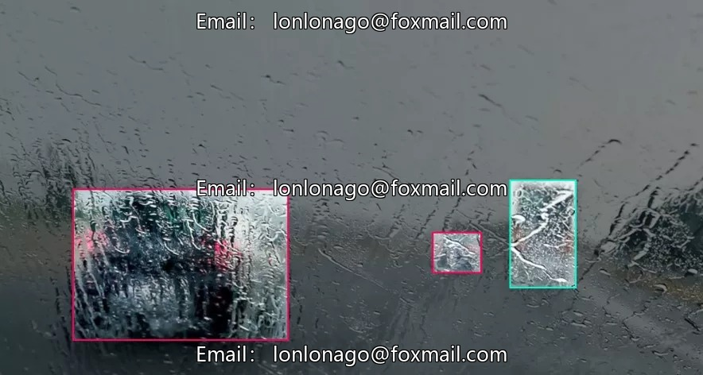
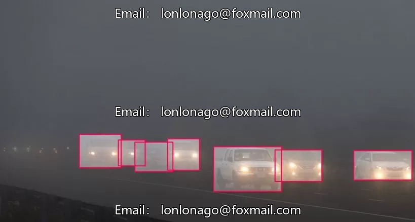

# Autonomous driving dataset for rainy, foggy, and snowy road conditions

## Body

Autonomous Driving Road Dataset for Rainy, Foggy, and Snowy Conditions
Contains 1012 images with 10 object categories annotated
7 sub-datasets for scene training in various weather conditions
Suitable for research and development of autonomous driving environment perception algorithms
Data format is image files, with clear and accurate annotations
Can be used for model training and testing to improve recognition accuracy under adverse weather conditions
Virtual material, once sold, cannot be returned.
Interested friends, click "I want" now!

## Images

## Payment

Here is a pay link on Stripe ( https://buy.stripe.com/3cs8yP7sY87d0vu9AB ). Please contact me lonlonago@foxmail.com after funding $89, and I will send you a complete data files , thank you!

